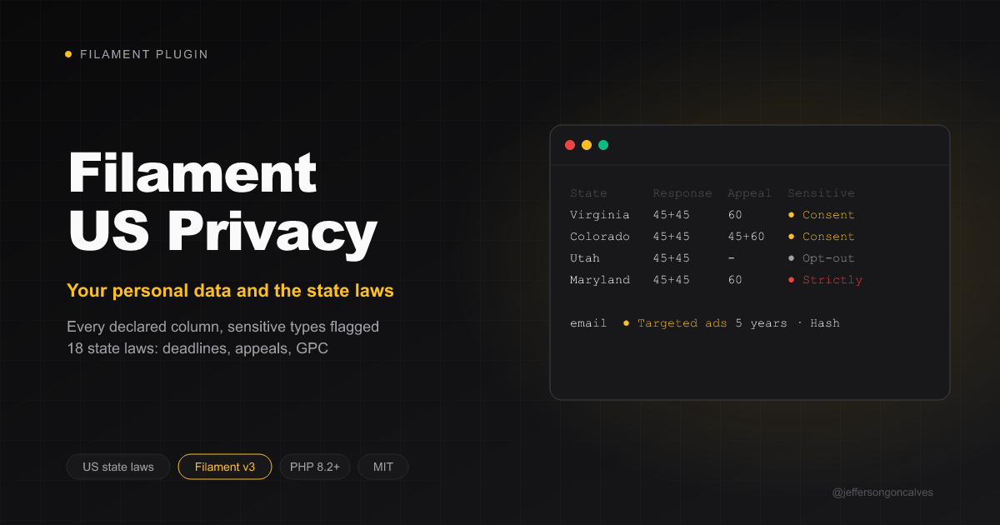

<div class="filament-hidden">



</div>

# Filament US Privacy

[](https://packagist.org/packages/jeffersongoncalves/filament-us-privacy)
[](https://github.com/jeffersongoncalves/filament-us-privacy/actions?query=workflow%3Atests+branch%3A1.x)
[](https://github.com/jeffersongoncalves/filament-us-privacy/actions?query=workflow%3A"Fix+PHP+code+styling"+branch%3A1.x)
[](https://packagist.org/packages/jeffersongoncalves/filament-us-privacy)
[](LICENSE.md)

Two read-only pages for your Filament panel, built on [laravel-us-privacy](https://github.com/jeffersongoncalves/laravel-us-privacy):

- **Personal data inventory**: every column you declared with `#[PersonalData]`, grouped by model, with whether it is sensitive (and which kind), its purpose, whether you sell it or use it for targeted advertising or profiling, its retention and deidentification strategy.
- **State laws**: the rules of the 18 US state privacy laws as configured in your app: effective dates, request and appeal deadlines, the sensitive data model, when Global Privacy Control must be honored, assessments and minors.

> This plugin gives you tooling. It does not make you compliant on its own.

## Features

- One card per model in `us-privacy.models`, one row per declared column.
- Sensitive data highlighted with its type; sale, targeted advertising and profiling flagged.
- The state law matrix, with the laws not yet in force marked.
- 19 languages.

## Compatibility

| Plugin Version | Filament |
|---|---|
| [1.x](https://github.com/jeffersongoncalves/filament-us-privacy/tree/1.x) | 3.x |
| [2.x](https://github.com/jeffersongoncalves/filament-us-privacy/tree/2.x) | 4.x |
| [3.x](https://github.com/jeffersongoncalves/filament-us-privacy/tree/3.x) | 5.x |

## Installation

```bash
composer require jeffersongoncalves/filament-us-privacy:"^1.0"
```

Declare your personal data and register the models as described in [laravel-us-privacy](https://github.com/jeffersongoncalves/laravel-us-privacy).

## Usage

```php
use JeffersonGoncalves\Filament\UsPrivacy\UsPrivacyPlugin;

public function panel(Panel $panel): Panel
{
    return $panel
        ->plugins([
            UsPrivacyPlugin::make()
                ->navigationGroup('Privacy')            // default: no group
                ->navigationSort(1)                     // the state laws page comes right after
                ->navigationIcon('heroicon-o-finger-print')
                ->slug('personal-data-inventory'),      // the state laws page: {slug}-states
        ]);
}
```

All fluent methods are optional.

> The pages have no authorization of their own: register the plugin only on panels whose users may see them, or override `canAccess()` in a subclass.

## Related plugins

- [filament-us-privacy-opt-out](https://github.com/jeffersongoncalves/filament-us-privacy-opt-out): opt-outs, sensitive data consent and Global Privacy Control.
- [filament-us-privacy-requests](https://github.com/jeffersongoncalves/filament-us-privacy-requests): consumer requests and appeals.
- [filament-us-privacy-notices](https://github.com/jeffersongoncalves/filament-us-privacy-notices): processing activities behind the privacy notice.
- [filament-us-privacy-assessments](https://github.com/jeffersongoncalves/filament-us-privacy-assessments): data protection assessments.
- [filament-us-privacy-vendors](https://github.com/jeffersongoncalves/filament-us-privacy-vendors): processors and third parties.
- [filament-us-privacy-minors](https://github.com/jeffersongoncalves/filament-us-privacy-minors): age checks, guardians and minors' consent.

## Testing

```bash
composer test
```

## Changelog

Please see [CHANGELOG](CHANGELOG.md) for more information on what has changed recently.

## Contributing

Please see [CONTRIBUTING](.github/CONTRIBUTING.md) for details.

## Security Vulnerabilities

Please review [our security policy](../../security/policy) on how to report security vulnerabilities.

## Credits

- [Jefferson Gonçalves](https://github.com/jeffersongoncalves)
- [All Contributors](../../contributors)

## License

The MIT License (MIT). Please see [License File](LICENSE.md) for more information.
